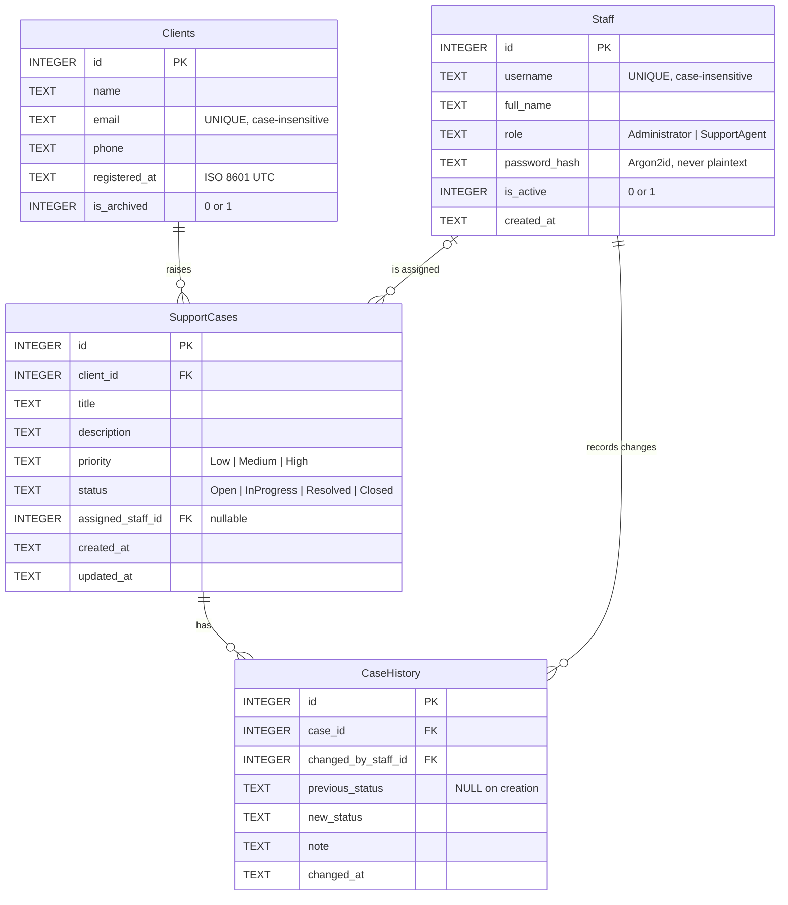

# Client Support Management System (CSMS)

A command-line **client support management system** written in modern C++17 with SQLite.
It tracks clients, support cases, staff accounts, and a tamper-evident history of every case
status change - the core of a small help-desk.

  

## Problem statement

A small support team needs one place to record **who its clients are**, **which problems they
have reported**, **who is working on each problem**, and **what happened along the way** -
without a spreadsheet that anyone can silently edit. CSMS provides that as a self-contained
terminal application with enforced business rules, role-based permissions, and an audit trail.

## Features

| Area | What it does |
|---|---|
| **Clients** | Register with auto-generated ID; validated name/email/phone; duplicate prevention (case-insensitive email); update, search (name/email/phone), view; **archive instead of delete** (and restore) |
| **Support cases** | Linked to existing clients; priority Low/Medium/High; status Open / In Progress / Resolved / Closed; assign to agents; search and filter by ID, client, status, priority and assignee |
| **Workflow rules** | Enforced status transitions; a case must be assigned before work starts; resolved cases come back only through an explicit, reason-required *reopen* |
| **Staff** | Administrator and Support Agent roles; deactivate instead of delete; deactivated staff cannot log in or receive assignments; history keeps pointing at them |
| **Case history** | Every creation and status change is recorded (who, from, to, note, when) **in the same database transaction** as the change |
| **Authentication** | Login/logout, Argon2id password hashes (libsodium), administrator-only operations, first-run admin setup (no default password) |
| **Reports** | Total clients; cases by status and priority; cases per staff member; unassigned cases |

## Technology stack

| Purpose | Choice |
|---|---|
| Language | C++17, standard library first |
| Storage | SQLite3 (prepared statements, foreign keys, transactions) |
| Build | CMake >= 3.16 |
| Tests | GoogleTest (238 tests) |
| Password hashing | **libsodium** (Argon2id) - an established library; no custom cryptography |
| Version control | Git |

### External dependencies

| Library | Why | Install |
|---|---|---|
| SQLite3 | persistent storage | `libsqlite3-dev` / `brew install sqlite` |
| libsodium | password hashing | `libsodium-dev` / `brew install libsodium` |
| GoogleTest | unit tests only | `libgtest-dev` / `brew install googletest` (downloaded automatically if missing) |

Authentication is isolated in a single class (`PasswordHasher`), the only file that includes
libsodium, so the dependency is easy to audit or replace.

## Architecture

```
 +-----------------------------------------------------------+
 |  Presentation   cli/        menus, prompts, formatting     |   no SQL
 +-----------------------------------------------------------+
 |  Service        services/   validation, rules, permissions,|   no SQL, no console
 |                             workflows, transactions        |
 +-----------------------------------------------------------+
 |  Repository     repositories/   one class per table:       |   no console, no rules
 |                                 SQL <-> model objects      |
 +-----------------------------------------------------------+
 |  Database       database/   connection (RAII), schema,     |   only place that
 |                             prepared statements, transactions|  includes sqlite3.h
 +-----------------------------------------------------------+
        models/ (plain structs + enum class)   common/ (exceptions, validation, time)
```

**Rules that keep it clean** (and which the code follows - checked with a grep audit):

* The CLI never executes SQL and never includes a repository or database header.
* Repositories never read or print anything.
* No global mutable state: `main()` builds every object once and passes dependencies through
  constructors (a *composition root*). Who is logged in lives in a `Session` object that is
  injected into the services that need it.
* Permissions and business rules live in the **service layer**, so they hold no matter which
  front end calls them - and can be unit-tested without a terminal.

### Key classes

| Class | Responsibility |
|---|---|
| `Database` | Owns the SQLite connection (RAII); enables foreign keys; creates/versions the schema |
| `Statement` | RAII prepared statement; values can only be *bound*, never concatenated -> no SQL injection |
| `Transaction` | Scope guard: rolls back automatically unless `commit()` is reached |
| `*Repository` | All SQL for one table; translates DB failures into domain exceptions |
| `CaseWorkflow` | The status state machine as pure functions |
| `CaseService` | Case rules; writes the case change and its history row in one transaction |
| `ClientService`, `StaffService` | Validation, duplicate/safety rules, permissions |
| `AuthService`, `Session`, `PasswordHasher` | Login/logout, who-is-acting, Argon2id hashing |
| `ReportService` | Aggregates report data |
| `Console`, `Format`, `*Menu`, `Application` | Terminal I/O, formatting, screens, top-level flow |

### Error handling

All deliberate errors derive from `CsmsError`: `ValidationError`, `NotFoundError`,
`DuplicateError`, `InvalidTransitionError`, `AuthenticationError`, `AuthorizationError`,
`DatabaseError`. The CLI wraps each action in `Console::runGuarded`, which prints
`Error: <readable message>` and carries on - invalid input never crashes the program. Closing
the input stream (Ctrl-D) ends the session cleanly.

## Database schema

Four tables: `Clients`, `Staff`, `SupportCases`, `CaseHistory`.



Integrity is enforced **by the database itself**, not only by the C++ code:

* primary and foreign keys (`PRAGMA foreign_keys = ON` for every connection), all
  `ON DELETE RESTRICT` - nothing referenced by history can be deleted;
* `NOT NULL`, `UNIQUE COLLATE NOCASE` (email, username) and `CHECK` constraints on every
  enum-like column;
* indexes on the columns the application filters by;
* timestamps stored as UTC ISO 8601 text (`2026-11-01T14:30:00Z`), which sorts chronologically;
* the schema version is stored in `PRAGMA user_version`, and a database from a *newer*
  version is refused rather than corrupted.

More detail: [docs/er-diagram.md](docs/er-diagram.md).

## Business rules

### Case status workflow

```
            +------------------------------+
            v                              |
  Open ---------> In Progress ---------> Resolved ---------> Closed (final)
   ^                  |                       |
   +------------------+                       |
   ^                                          |
   +---------- reopen (explicit, reason required)
```

* `Open -> In Progress` requires an **assigned support agent**.
* `Resolved -> Open` is **not** an ordinary status change; it needs the explicit *reopen*
  operation and a written reason.
* `Closed` is final. Anything not drawn above is rejected with a message listing what *is* allowed.

### Permissions

| Operation | Logged out | Support Agent | Administrator |
|---|:-:|:-:|:-:|
| Register / update / search / view clients | no | yes | yes |
| Archive / restore clients | no | no | **yes** |
| Create / view / search cases, assign, change status, reopen, view history | no | yes | yes |
| View reports and the staff list | no | yes | yes |
| Create / edit / deactivate / reactivate staff, reset passwords | no | no | **yes** |
| Change own password | no | yes | yes |
| Create the first administrator | only while **no accounts exist** | | |

Extra safety rules: you cannot deactivate yourself or change your own role, and the last
active administrator can never be deactivated or demoted.

## Folder structure

```
client-support-system/
├── CMakeLists.txt
├── README.md
├── .gitignore                  # build output and *.db files are never committed
├── docs/
│   ├── requirements.md
│   ├── architecture.md
│   └── er-diagram.md
├── include/                    # public headers, one folder per layer
│   ├── common/                 # exceptions, validation, time
│   ├── models/                 # Client, Staff, SupportCase, CaseHistoryEntry, Report, enums
│   ├── database/               # Database, Statement, Transaction, Schema
│   ├── repositories/           # Client / Staff / Case / History / Report repositories
│   ├── services/               # services, Session, PasswordHasher, CaseWorkflow
│   └── cli/                    # Console, Format, menus, Application
├── src/                        # implementations mirror include/; main.cpp is the composition root
├── tests/                      # GoogleTest suites + shared fixtures
└── data/                       # runtime database (git-ignored, only .gitkeep is tracked)
```

## Build and run

```bash
# Debian / Ubuntu
sudo apt install build-essential cmake pkg-config libsqlite3-dev libsodium-dev libgtest-dev
# macOS (Homebrew)
brew install cmake pkg-config sqlite libsodium googletest
```

```bash
cmake -S . -B build
cmake --build build
./build/csms                      # uses data/csms.db (created on first run)
./build/csms --db /tmp/demo.db    # or choose another file
./build/csms --help
```

Options: `-DCSMS_BUILD_TESTS=OFF` skips the tests (and the GoogleTest requirement);
`-DCMAKE_BUILD_TYPE=Release` builds optimised.

**First run:** there are no accounts, so the program asks you to create the first
administrator. No default username or password is ever shipped. Run it from the project root
so the relative `data/` path resolves, or pass `--db` with an absolute path.

Data lives in the SQLite file, so everything survives restarts. Never commit `*.db` files
(they are git-ignored).

## CLI usage - example terminal session

Real output from the program (menus abbreviated with `...` for length). Typed input is shown
after each prompt; note the password is not echoed.

```text
==========================================
   Client Support Management System
==========================================
First-time setup: no accounts exist yet.
Create the first administrator account.
Username: admin
Full name: Alice Admin
New password:
Repeat new password:
Administrator 'admin' created. You can now log in.

--- Login ---
Username (blank to quit): admin
Password:
Welcome, Alice Admin.

=== Main Menu - admin (Administrator) ===
  1) Clients
  2) Support cases
  3) Reports
  4) Staff management (administrator)
  5) Change my password
  0) Log out
Choose: 1
...
Choose: 1
Full name: Acme Corp
Email: support@acme.com
Phone: +1 555 010 2000
Registered client #1: Acme Corp
...
=== Support Cases ===
  1) Create case
  2) View case and its history
  ...
Choose: 1
Client ID: 1
Title: Cannot log in to portal
Description: Password reset email never arrives

=== Priority ===
  1) Low
  2) Medium
  3) High
  0) Cancel
Choose: 3
Created case #1 (status Open, unassigned).
...
Choose: 4
Active support agents:
ID   Username            Name                      Role           Status
---------------------------------------------------------------------------
2    bob                 Bob Builder               Support Agent  Active
Case ID: 1
Staff ID to assign: 2
Case #1 is now assigned to bob.
...
Choose: 5
Case ID: 1

=== Change status of case #1 (now Open) ===
  1) In Progress
  0) Cancel
Choose: 1
Note (optional): Checking the mail logs
Case #1 is now In Progress.
...
Choose: 5
Case ID: 1

=== Change status of case #1 (now In Progress) ===
  1) Open
  2) Resolved
  0) Cancel
Choose: 2
Note (optional): Link re-sent, customer confirmed
Case #1 is now Resolved.
...
Choose: 2
Case ID: 1
Case #1
  Title:       Cannot log in to portal
  Client:      Acme Corp (ID 1)
  Description: Password reset email never arrives
  Priority:    High
  Status:      Resolved
  Assigned to: bob
  Created:     2026-11-01 19:19 UTC
  Updated:     2026-11-01 19:19 UTC
History:
  When                 Change                      By              Note
  -------------------------------------------------------------------------------------
  2026-11-01 19:19 UTC (new) -> Open               admin           Case created
  2026-11-01 19:19 UTC Open -> In Progress         admin           Checking the mail logs
  2026-11-01 19:19 UTC In Progress -> Resolved     admin           Link re-sent, customer confirmed
...
Choose: 3
========== Support System Report ==========

Clients
  Total registered: 1
  Active:           1
  Archived:         0

Cases by status (total 1)
  Open              0
  In Progress       0
  Resolved          1
  Closed            0

Cases by priority
  Low               0
  Medium            0
  High              1

Cases assigned to each staff member
  Staff                     Total   Open / In Progress
  ----------------------------------------------------
  Bob Builder               1       0
  Unassigned cases: 0

===========================================
```

An invalid action is explained, not fatal (example; this exact message is asserted by an automated test):

```text
Choose: 5
Case ID: 7
Error: Assign the case to a support agent before moving it to In Progress
```

## Testing

```bash
cd build && ctest --output-on-failure      # or: ./build/tests/csms_tests
./build/tests/csms_tests --gtest_filter='CaseHistory*'    # run one suite
```

**238 tests**; every test uses an in-memory or temporary database (never `data/`).

| Requirement | Where it is tested |
|---|---|
| Client registration & duplicate prevention | `test_client_service`, `test_client_repository` |
| Client updates & archiving | `test_client_service` |
| Case creation, invalid client references | `test_case_service`, `test_case_repository`, `test_database` |
| Case assignment (active agents only) | `test_case_service` |
| Valid / invalid status transitions | `test_case_workflow` (all 16 pairs), `test_case_service` |
| Case history creation | `test_case_history` |
| Database persistence across restarts | `test_database`, `test_client_service`, `test_case_history`, `test_auth_service` |
| **Transaction rollback** | `test_case_history` - a real foreign-key failure *after* the case row was updated proves both writes are undone |
| Authorization restrictions | `test_authorization`, `test_staff_service` |
| Password hashing & login | `test_password_hasher`, `test_auth_service` |
| Reports | `test_reports` |
| The CLI itself | `test_cli` - scripted keyboard input drives the real `Application` |

Techniques worth knowing for an interview: real SQLite in tests instead of mocks;
shared fixtures (`ServiceFixture`); constraint tests that prove the *database* rejects bad
data even if the C++ checks were bypassed; and **mutation checks** done during development
(deliberately breaking a rule - removing a transaction, an admin check, the LIKE escaping -
and confirming a test fails). The suite also passes under AddressSanitizer + UBSan and in a
Release build.

## Security notes

* Passwords: Argon2id via libsodium, per-password random salt; only the encoded hash is stored.
  Password input is not echoed on POSIX terminals.
* Every SQL value is a bound parameter; user text in `LIKE` searches is escaped. Tests store
  `Robert'); DROP TABLE Clients;--` as an ordinary name.
* Login failures are indistinguishable (same message and similar timing) for unknown users,
  wrong passwords and deactivated accounts; five failures end the program.
* No credentials in the repository: no default password, and database files are git-ignored.

## Design decisions (and why)

| Decision | Reasoning |
|---|---|
| Rules in services, not the CLI | Permissions/workflow hold for any front end and are unit-testable |
| `Session` injected, not global | Explicit dependencies; tests can act as any user |
| Case + history in one transaction | The audit trail can never disagree with the case |
| Archive/deactivate, never delete | Preserves history; `ON DELETE RESTRICT` backs it up in the schema |
| Service checks *and* DB constraints | Friendly messages first; the constraint is the safety net against races |
| `Console` takes streams | The whole CLI is testable with scripted input |
| Assignment is **not** a history row | The spec records *status* changes; assignment events are listed under future work |
| Archiving a client does not close their cases | Archive is a soft flag; existing cases continue, only *new* cases are blocked |
| Pragmatic email validation | A full RFC 5322 parser is over-engineering; the unique constraint and a confirmation email would be the real check |

## Known limitations

* Single-user, single-process design: duplicate checks run before the write, with the
  database constraint as the final guard. There is no concurrent multi-user locking story.
* A running session keeps the role it logged in with; deactivating or demoting someone takes
  effect at their next login.
* Table columns are aligned by byte count, so wide Unicode text may misalign slightly.
* Password echo suppression is implemented for POSIX terminals only.
* Names are limited to 100 bytes (not characters) for multi-byte text.

## Future improvements

* Record assignment changes in the history; allow un-assigning and editing case title/priority.
* Case comments / internal notes and attachments metadata.
* Pagination and sorting for long lists; CSV export of reports.
* Account lock-out with back-off, password-strength rules, session timeout.
* Configuration file and a `--version` flag; Windows echo suppression.
* Migrations framework beyond the single `user_version` check.
* CI pipeline (build + tests + sanitizers) on GitHub Actions.
