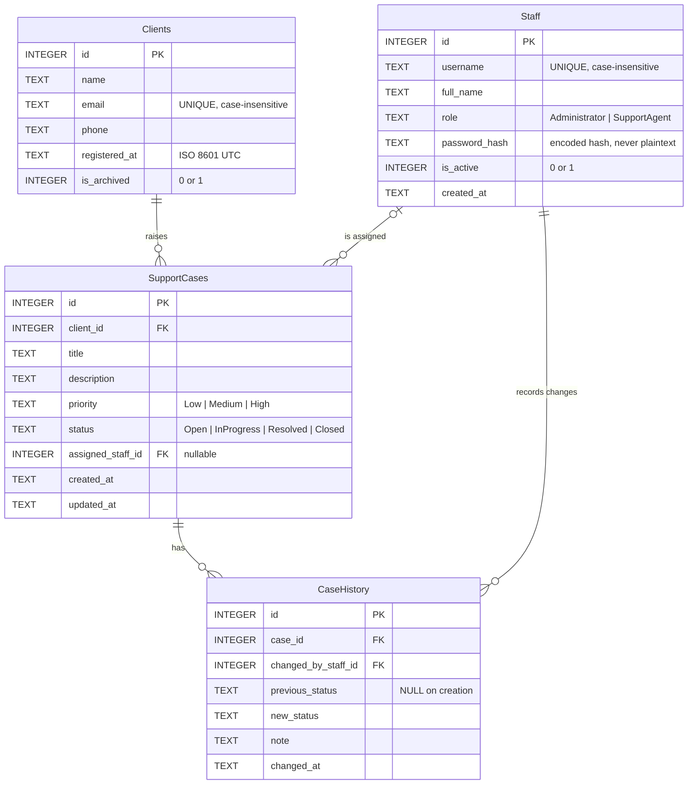

# Entity-Relationship Diagram

## Design rules enforced by the schema
- Every foreign key is `ON DELETE RESTRICT`: records referenced by cases or history cannot be
  deleted. Clients are archived and staff deactivated instead, preserving history.
- Enum-like columns carry `CHECK` constraints, so invalid values cannot be stored.
- Email and username are unique regardless of letter case.
- Indexes cover the filters the application uses: case client, status, priority, assignee,
  and history by case + time.
  and history by case + time.
- Timestamps are `YYYY-MM-DDTHH:MM:SSZ` text, which sorts chronologically.
